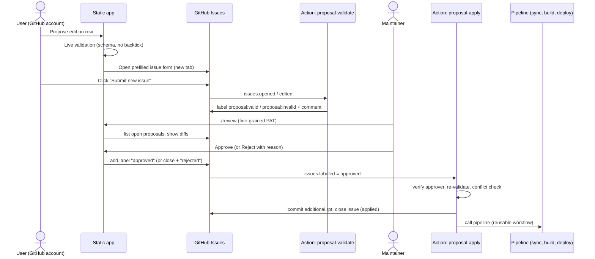

# PLAN — ecw item keys Browser

The app joins the **itemkeys rpt**
(exported from `mobiledoc.dbo.itemkeys`) with an app-managed **additional rpt**, and serves
them as one fast, searchable, filterable table on desktop and mobile, with per-row
discussion and maintainer-approved edits. A new itemkeys export can be dropped in at any
time. The app records when each key first appeared and when it disappeared.

> **Delimiter.** Both rpts are delimited by a **backtick** (`` ` ``), not `|`. The delimiter is a
> single constant (`DELIMITER` in `src/lib/data/rpt.ts`). Users may type line breaks
> in edits, but never `` ` ``.

---

## 1. Decisions (confirmed with the owner)

| Topic                 | Decision                                                                                                                                                                                                                                                                                                                                          |
| --------------------- | ------------------------------------------------------------------------------------------------------------------------------------------------------------------------------------------------------------------------------------------------------------------------------------------------------------------------------------------------- |
| Repo / site           | `takitotech-clinical/ecwitemkeys`, **public**, served by **GitHub Pages** at `https://ecwitemkeys.takitotech.com/`, built and deployed by GitHub Actions. No server, no Worker.                                                                                                                                                    |
| Edits                 | Users propose edits to the **user-editable additional columns only**: never `key`, never itemkeys columns, never the managed `added`/`expired` dates. Proposals become **GitHub Issues** created from a prefilled issue form.                                                                                                                     |
| Approval              | **In-app review queue.** Approver list at launch: **`TriStarGodAI`**, extendable in `config/approvers.json`. Approving applies the change through a GitHub Action, which commits and redeploys.                                                                                                                                                   |
| Discussion            | **GitHub Discussions**, one thread per key, embedded in the app with **giscus**.                                                                                                                                                                                                                                                                  |
| itemkeys export       | `SELECT i.name 'key', i.supportRemarks 'ecw_remarks', i.displayname 'display_name' FROM mobiledoc.dbo.itemkeys i ORDER BY i.name`, saved by SSMS as `source/itemkeys.rpt`.                                                                                                                                                                    |
| itemkeys refresh      | The owner may **replace `source/itemkeys.rpt` with a new sorted export at any time**. It may have more or fewer keys than the last one. The app syncs `additional.rpt` automatically (§2.6).                                                                                                                                                      |
| itemkeys format       | A raw SSMS "results to file" export: UTF-8 **with BOM**, **CRLF**, one header line, the literal `NULL` for SQL NULL, and an SSMS **footer** (blank line, `(N rows affected)`, blank lines, `Completion time: …`). Values may contain line breaks and leading or trailing whitespace. Rows are in SQL Server collation order by key.               |
| Additional layout     | **Dense, auto-append.** There is one row per key ever seen. New keys are inserted automatically, in itemkeys order, when a new export arrives. Rows are never deleted; keys that disappear get an `expired` date.                                                                                                                                 |
| Additional columns    | ``key`added`expired`description`category``. `added` and `expired` are **managed** UTC timestamps that users can never edit; the browser shows them in the viewer's local timezone. `description` (text, line breaks allowed, up to 2,000 characters) and `category` (enum: `system`; empty = unset) are user-editable, including on expired keys. |
| Returning keys        | A key that comes back after expiring has `expired` **cleared**. `added` is kept.                                                                                                                                                                                                                                                                  |
| Default view          | **Active keys only**. Expired keys are one filter click away.                                                                                                                                                                                                                                                                                     |
| Bad exports           | There is **no mass-expiry guard**. A wrong export is undone by reverting its commits (§8).                                                                                                                                                                                                                                                        |
| Additional strictness | **Fully app-managed and strict.** No ragged rows, every record has exactly one field per header column, and line breaks inside values are allowed.                                                                                                                                                                                                |
| Key collisions        | Case-only or whitespace-only key collisions are **not expected**. The app warns if one appears and does not otherwise handle it.                                                                                                                                                                                                                  |
| Stack                 | **SvelteKit (Svelte 5) + TypeScript + Vite**, `adapter-static`, Vitest, Playwright, pnpm. This matches the existing devcontainer.                                                                                                                                                                                                                 |

---

## 2. Additional rpt design

### 2.1 Files

```
source/
  itemkeys.rpt            # SSMS export; owner replaces it at will; never written by automation
  additional.rpt          # app-managed: sync + approved edits only
  additional.schema.json  # column definitions for additional.rpt
  itemkeys.expired.rpt    # app-managed: last-known itemkeys values of expired keys (§2.6)
config/
  approvers.json          # ["TriStarGodAI"]
```

### 2.2 Columns

| #   | Column        | Kind                      | Rules                                                                                                                                                     |
| --- | ------------- | ------------------------- | --------------------------------------------------------------------------------------------------------------------------------------------------------- |
| 1   | `key`         | identity                  | Exact itemkeys key, whitespace included. Unique. Never edited.                                                                                            |
| 2   | `added`       | **managed** UTC timestamp | `YYYY-MM-DDTHH:MM:SSZ` (§2.5). The time the app first processed the key. Always set. Never changes afterwards, even if the key expires and later returns. |
| 3   | `expired`     | **managed** UTC timestamp | Same format, or empty. The time the app **first** saw the key missing from itemkeys. Empty while the key is active. **Cleared** if the key returns.       |
| 4   | `description` | user, text                | Free text with **line breaks allowed**; `maxLength` 2000 (§6.1 explains why this fits).                                                                   |
| 5   | `category`    | user, enum                | `system`, or empty (unset).                                                                                                                               |

**Order rules**

- The managed columns always come right after `key`.
- New **user** columns are appended at the end. Columns are never reordered.

### 2.3 Format rules

1. **The header is exact.** It must equal `key`, then the schema's columns in order. Any
   mismatch is a hard error.
2. **Rows are strict and full-width.** Every record has exactly one field per header column
   (4 delimiters with the 5 columns above). There are no ragged rows, no extra fields, and no
   blank lines between records. Any violation is a hard error.
3. **Line breaks inside values are allowed**, for example a multi-line `description`. They are
   read with the same deterministic multi-line parser as itemkeys (§3.2).
   - **Why this is safe:** the key never contains a line break, and no value ever contains a
     backtick. So every record's first line contains a delimiter, and a line without one is
     always a continuation.
   - **How they are written:** as the file's line ending (CRLF). The parser accepts CRLF or LF
     and normalizes them to `\n` in memory.
4. **The file is dense.** There is one row per key ever seen in any itemkeys export. Rows are
   **never deleted**, and an all-empty user section is normal.
5. **Rows follow itemkeys order (`ORDER BY i.name`), which is SQL Server collation order.**
   - **Why not sort in code:** that order is not ordinal, case-insensitive, or `Intl.Collator`
     order. For example, `ANSI5010` sorts after `ANSI_SendFirstDxOnlyForAllPayers`, and
     `edi-default-…` sorts before `edi_270_…`. JavaScript cannot reproduce it reliably.
   - **Placing a new key:** sync inserts it **immediately after the nearest preceding key (in
     the new `itemkeys.rpt` order) that already has a row**, or at the top if there is none.
     The file therefore stays in SQL order without implementing the collation.
   - **Expired rows stay where they are.** Nothing ever re-sorts the file, so diffs stay
     minimal.
6. **An empty field means "unset".** The literal `NULL` is rejected as a value.
7. **Forbidden in user values:** the delimiter `` ` ``; control characters other than line
   breaks (tab included); leading or trailing whitespace on the whole value (the form trims
   it); and the exact string `NULL`.
   - **Allowed:** `|` and line breaks.
   - Forbidding the backtick also means values can never break the Markdown code fences in
     proposal issues (§6).
8. **The file's conventions are preserved.** UTF-8 with BOM and CRLF, as seeded. The writer
   detects and keeps both. `.gitattributes` marks `source/*.rpt -text`, so git never rewrites
   line endings.
9. **The file has no SSMS footer.** The seed's footer is removed once during adoption (§2.7).
   After that, a footer in `additional.rpt` is a hard error.
10. **Only automation and maintainer scripts write the file.** Every write is canonical, and
    only the touched lines change; all other lines stay byte-for-byte identical. CI rejects
    any commit whose `additional.rpt` fails validation.
11. **No audit columns beyond the dates.** Git history is the audit trail for edits. Each apply
    commit records the issue number, the proposer, and the approver.

### 2.4 Schema file

`source/additional.schema.json`:

```json
{
  "version": 2,
  "columns": [
    {
      "id": "added",
      "label": "Added",
      "type": "timestamp",
      "managed": true,
      "required": true
    },
    {
      "id": "expired",
      "label": "Expired",
      "type": "timestamp",
      "managed": true
    },
    {
      "id": "description",
      "label": "Description",
      "type": "text",
      "multiline": true,
      "maxLength": 2000,
      "help": "Plain-language description of what this item key is for."
    },
    {
      "id": "category",
      "label": "Category",
      "type": "enum",
      "values": ["system"],
      "help": "system = item key the program depends on; do not change."
    }
  ]
}
```

**Column types**

- `type: "timestamp"`: a UTC ISO-8601 timestamp, `YYYY-MM-DDTHH:MM:SSZ`. It is displayed in the
  viewer's local timezone, filterable by date facet (§4.3), and sortable.
- `type: "text"`: free text. `multiline: true` allows line breaks and gives the editor a
  textarea that accepts Enter. Searched by full-text search.
- `type: "enum"`: shown as a dropdown in the editor and as a facet filter with counts. Empty
  (unset) is always allowed. New allowed values are added to `values` by a maintainer.

**Managed columns**

- `managed: true` means only sync can write the column. Users can never edit it: it never
  appears in the edit form, and the validate and apply Actions reject a proposal that tries to
  set it.
- Managed columns must come directly after `key`.

**Optional per-column fields:** `maxLength` (default 500), `help`, `searchable` (default true
for text), `facet` (default true for enum and timestamp).

### 2.5 Timestamps: stored in UTC, shown in the viewer's timezone

- **Storage.** `added` and `expired` hold UTC timestamps in a fixed format,
  `YYYY-MM-DDTHH:MM:SSZ` (e.g. `2026-11-04T14:03:27Z`). The value is the time the sync run
  started, so **every key touched by one sync shares the same timestamp**.
- **Why timestamps, not dates.** A date alone can't be shown correctly in other timezones. The
  fixed-width format also sorts correctly as a string and is easy to read in the raw file.
- **Display.** The browser converts with `Intl.DateTimeFormat` in the viewer's own timezone.
  - Table and cards show the short local date, e.g. "Nov 4, 2026".
  - RowDetail shows the full local date and time with the zone abbreviation; the UTC value is
    in a tooltip.
  - The same conversion applies to `exportedAt`, which is read from the SSMS footer with its
    `-05:00` offset.
- **Overrides.** `pnpm data:sync --now 2026-11-04T14:00:00Z` sets the time for tests and
  backfills.

### 2.6 Sync: applying a new itemkeys export (`scripts/sync.ts`, `pnpm data:sync`)

Sync runs automatically in the pipeline on every push to `main` (§8). It is **idempotent**:
re-running it with no new export changes nothing. The owner can also run it locally before
committing.

**Inputs**

- The new `source/itemkeys.rpt`.
- The current `additional.rpt` and `itemkeys.expired.rpt`.
- The **previous** itemkeys export, used only to archive the last-known values of keys that
  expire. It comes from git: `github.event.before` in CI, or `HEAD` locally.
- `now`, the UTC timestamp of this sync run (§2.5).

**Algorithm.** Parse everything strictly and abort on any error, with no partial writes. With
`K` = the new itemkeys keys in file order:

1. **New keys** (in `K`, no row in `additional`): insert a row with `added = now`,
   `expired = ""`, and empty user columns, positioned by §2.3 rule 5.
2. **Expired keys** (row has an empty `expired`, key not in `K`):
   - set `expired = now`;
   - copy the key's itemkeys row from the previous export into `itemkeys.expired.rpt`, so the
     app can still show its last-known `ecw_remarks` and `display_name`.
3. **Returning keys** (row has a non-empty `expired`, key back in `K`): **clear `expired`**,
   keep `added` unchanged, and remove the key from `itemkeys.expired.rpt`.
4. **Everything else** is untouched.

**Checks**

- The only check on the export itself is the footer row count, which catches a cut-off file.
  There is **no mass-expiry guard**: a wrong export is undone with git (§8, "Undoing a bad
  export").
- **Possible renames:** if a newly added key and a newly expired key differ only by case or
  surrounding whitespace, this is listed as a "possible rename" warning in the summary.

**Output**

- Commit message:
  `Sync itemkeys (export 2026-12-01T14:12:00Z): +12 added, 3 expired, 1 returned`.
- A job summary listing each key in every category.
- If nothing changed, there is no commit.

**`itemkeys.expired.rpt`**

- It has the same header and format as `itemkeys.rpt` (BOM, CRLF, strict parsing) but no
  footer.
- It contains exactly the expired keys whose last-known values were available, in
  `additional.rpt` order.
- It is managed only by sync.

### 2.7 One-time adoption of the seed (`pnpm data:adopt-additional`, Phase 1)

This converts the current 3-column seed (``key`description`category``, 4,358 rows, with an SSMS
footer) to the managed format:

1. Strip the SSMS footer.
2. Insert the `added` and `expired` columns after `key`. Set `added` to the **adoption
   timestamp** (the UTC time the script runs) for every row, and leave `expired` empty.
3. Write a header-only `itemkeys.expired.rpt`.
4. Validate, then commit as one reviewed commit. Diffing the result with whitespace ignored
   should show only the two inserted columns and the removed footer.

### 2.8 Column maintenance scripts

These are maintainer scripts. Each one writes canonical, validated output.

- `pnpm data:add-column <id> --type text|enum|date [--multiline] [--values a,b] [--label "…"]`:
  appends a **user** column to the schema and header, and adds an empty field to every row.
  This produces one large commit.
- `pnpm data:rename-column <old> <new>`: changes the schema and header only, because the
  position stays the same.
- `pnpm data:remove-column <id>`: removes the column from the schema, the header and every row.
  It asks for confirmation if any row has data there. Managed columns cannot be removed.
- `pnpm data:sync`: §2.6.
- `pnpm data:check`: runs the full validation that CI runs (§3.4).

---

## 3. Data pipeline

### 3.1 Profile of the real export (2026-11-03)

| Fact                   | Value                                                                                                                                                                   |
| ---------------------- | ----------------------------------------------------------------------------------------------------------------------------------------------------------------------- |
| Columns                | ``key`ecw_remarks`display_name``                                                                                                                                    |
| Records                | 4,358, equal to the footer's `(4358 rows affected)`                                                                                                                     |
| Envelope               | UTF-8 BOM, CRLF, footer of `\r\n\r\n(4358 rows affected)\r\n\r\n\r\nCompletion time: …\r\n`                                                                             |
| Delimiters per record  | exactly 2 in every record; no backtick inside any value                                                                                                                 |
| Multi-line values      | 9 in `ecw_remarks`, 1 in `display_name` (`EnableMultipleCPTForNYVehicleForm`, 3 physical lines). Inner line breaks are a mix of CRLF and LF, including blank lines. |
| Surrounding whitespace | 6 keys with a trailing space (`MIPS_MigrateSettings_2021 ` … `_2026 `); 64 `ecw_remarks` and 10 `display_name` values                                               |
| `NULL`                 | `display_name` 3,298                                                                                                                                                    |
| Empty string           | `ecw_remarks` 998, `display_name` 212                                                                                                                               |
| Max lengths            | key 50, `ecw_remarks` 255, `display_name` 99                                                                                                                        |
| Keys                   | unique, also unique case-insensitively and after trimming; characters include space, `-`, `.`, `/`, `&`, `+`                                                            |
| Order                  | SQL Server collation order (§2.3 rule 5)                                                                                                                                |
| `\|` in values         | 2 `ecw_remarks` values (harmless now that the delimiter is a backtick)                                                                                              |
| Seed `additional.rpt`  | 4,358 rows in the same order, ``key`description`category``, 128 `category = system`, with an SSMS footer                                                                |

Size: the rpts are about 400 KB and 120 KB. The generated JSON should be about 140 KB
gzipped, which GitHub Pages serves compressed.

### 3.2 Parser (`src/lib/data/rpt.ts`, shared by the app build, scripts and Actions)

One strict record reader serves all three files. Each file has its own expected header and
its own footer policy.

**Envelope**

- Strip and remember a UTF-8 BOM. Detect and remember the dominant line ending.
- Footer: detect `\r?\n\r?\n\((\d+) rows? affected\)\r?\n[\s\S]*$`.
  - `itemkeys.rpt`: **required**. Strip it, and keep `N` and the `Completion time`. A missing
    footer is a warning, and the count check is skipped.
  - `additional.rpt` and `itemkeys.expired.rpt`: **forbidden** (hard error).
- Errors report the file name, physical line number(s), the key if known, and a snippet.

**Records** (H = header field count, so a complete record has exactly H − 1 delimiters)

Values never contain a backtick and keys never contain a line break. So **every record's first
line contains a delimiter**, and **a physical line with no delimiter always continues** the
field that is open. Parsing is deterministic.

1. **Start a record** at a physical line.
2. **While it has fewer than H − 1 delimiters,** append the next physical line, keeping the
   line break. Blank lines are kept.
3. **At exactly H − 1 delimiters:** a following line **with** a delimiter starts a new record,
   and a following line **without** one is appended to the last field. In itemkeys, that is
   `EnableMultipleCPTForNYVehicleForm`'s 3-line `display_name`.
4. **Past H − 1 delimiters, fail.**
5. `itemkeys.rpt`: the record count must equal the footer `N` (hard error).
6. **Values are kept exactly**: surrounding whitespace is preserved, inner line breaks are
   normalized to `\n` in memory, and in itemkeys files only the exact string `NULL` becomes
   `null`.
7. **Headers are exact:**
   - itemkeys files: ``key`ecw_remarks`display_name``;
   - additional: `key` plus the schema's columns.
8. **Keys are never trimmed**, must not contain line breaks, and must be unique.

**Writer** (`writeRpt`)

- Re-emits the detected BOM and line ending, and writes inner `\n` as that line ending.
- Writes no footer.
- Rewrites only changed records, full-width. All other lines are byte-identical.
- Inserts and removes whole records at the given positions.

### 3.3 Build step (`scripts/build-data.ts`, run before `vite build`)

1. Parse and validate all files and the schema.
2. **Assert sync state.** Every itemkeys key has a row with an empty `expired`, and every row
   with an empty `expired` is in itemkeys. In the deploy pipeline this always holds, because
   sync runs first. In PR CI a mismatch is a warning: "run `pnpm data:sync`".
3. **Join.** Rows are driven by `additional.rpt`, which lists every key ever seen, in file order.
   - **Active keys** take `ecw_remarks` and `display_name` from `itemkeys.rpt`.
   - **Expired keys** take them from `itemkeys.expired.rpt`, marked "last known", or leave them
     empty if those values aren't available.
4. Collect diagnostics:
   - exact duplicate keys (error);
   - case-only or whitespace-only collisions (warning; not expected);
   - keys and values with surrounding whitespace;
   - multi-line values;
   - expired keys with no last-known values;
   - the last sync's added, expired, returned and possible-rename lists.
5. Optionally query GitHub GraphQL with the workflow's `GITHUB_TOKEN` for **discussion
   comment counts per key** in the giscus category. Skipped locally if no token.
6. Emit `static/data/items.<contenthash>.json` in a compact columnar shape:
   ```json
   {
     "generatedAt": "2026-11-04T14:00:00Z",
     "exportedAt": "2026-11-03T18:06:30-05:00",
     "itemkeysColumns": ["key","ecw_remarks","display_name"],
     "additionalSchema": { "...schema..." },
     "rows": [["10eLoginPageContent","This is used to enable login page content","10eLoginPageContent","2026-11-04T14:03:27Z","","",""], "..."],
     "lastKnown": [123, 456],
     "discussions": { "HPI": 3 },
     "lastSync": { "at": "2026-11-04T14:03:27Z", "added": [], "expired": [], "returned": [], "possibleRenames": [] },
     "diagnostics": { "whitespaceKeys": ["MIPS_MigrateSettings_2023 ", "..."], "multilineValues": [], "collisions": [] }
   }
   ```
   `lastKnown` holds the indices of rows whose itemkeys values come from the expired archive.
   `exportedAt` comes from the itemkeys footer and is shown as "Data exported …".
7. Emit `static/data/version.json` → `{ "file": "items.<hash>.json", "generatedAt": "…" }`.
8. Write a summary to `$GITHUB_STEP_SUMMARY`: counts (total, active, expired), the last sync's
   changes, and warnings.

### 3.4 Validation rules (`src/lib/data/validate.ts`)

The same module runs in the browser (live form validation), in `pnpm data:check`, in CI, in
sync, and in the proposal Actions.

- **itemkeys** (`itemkeys.rpt` and `itemkeys.expired.rpt`):
  - header exact;
  - every record has exactly 2 delimiters;
  - `N` matches (export only);
  - keys non-empty, without line breaks, and unique;
  - collision warning (case-only or whitespace-only).
- **additional:**
  - header exact against the schema;
  - every record full-width, with no blank lines between records and no footer;
  - keys unique;
  - `added` is a valid UTC timestamp in the exact `YYYY-MM-DDTHH:MM:SSZ` format;
  - `expired` is empty or a valid timestamp at or after `added`;
  - user values pass their column rules (§2.3 rule 7, `maxLength`, `multiline`, enum
    membership, not `NULL`);
  - every key in `itemkeys.expired.rpt` has a non-empty `expired` in additional.
- **Proposed values:** the same user-value rules. Managed columns and `key` cannot be set.
- **Schema:**
  - ids are unique `snake_case`, and `key` is not declared as a column;
  - managed columns come first;
  - enum `values` are non-empty and contain no delimiter;
  - `multiline` only on text columns.

---

## 4. Front-end application

### 4.1 Structure

```
src/
  lib/
    data/        rpt.ts, validate.ts, schema.ts, types.ts, load.ts, dates.ts
    search/      normalize.ts, search.ts, facets.ts, sort.ts
    github/      issueUrl.ts, proposals.ts (REST client), auth.ts (PAT storage)
    components/  SearchBar, FacetPanel, FilterChips, DataTable, CardList,
                 VirtualList, RowDetail, ProposeEditForm, Discussion (giscus),
                 ReviewQueue, ProposalDiff, DataHealth, ChangesSummary
    state/       url-state.ts (query-string <-> state), prefs.ts (localStorage)
  routes/
    +layout.ts   (export const prerender = true; ssr = false for app routes)
    +page.svelte           main table
    review/+page.svelte    maintainer review queue
    health/+page.svelte    data diagnostics + sync history
    about/+page.svelte     how to contribute, how proposals work
```

- `adapter-static` with `paths.base` read from an env var (`BASE_PATH`, default `/ecwitemkeys`).
  CI builds with `BASE_PATH=` (empty) because the custom domain serves the site from `/`.
- Add `static/.nojekyll`, and a `404.html` fallback that redirects to the base path.

### 4.2 Loading

- On start, fetch `version.json` with `cache: 'no-cache'`, then fetch the hashed `items.*.json`.
  The hashed file is immutable, so browser caching is safe.
- When the window regains focus, and at most every 10 minutes, re-check `version.json`. If a
  new version exists, show a non-blocking banner: "Data updated — reload".
- Build the in-memory index once after loading (§4.3).

### 4.3 Search, filter and sort ("fast")

Targets, measured on a mid-range phone: **under 16 ms per keystroke at 4.5k rows, under 50 ms
at 50k rows**, 60 fps scrolling, and **under 2 s first load** on 4G.

- **Pre-normalization.** At load time, compute one normalized string per searchable column per
  row: lowercase, NFKD with diacritics stripped, and **all whitespace including line breaks
  collapsed to one space and trimmed**. Phrase searches therefore match across line breaks and
  ignore padding. No regex in the hot loop. The raw values are kept unchanged for display and
  copying.
- **Query syntax.** Whitespace-separated terms are ANDed. `"quoted phrase"` matches a phrase.
  `-term` excludes. `column:term` restricts a term to one column (`key:`, `remarks:`,
  `display:`, and any schema text column such as `description:`).
- **Matching.** A linear scan with `String.prototype.includes` over the pre-normalized strings.
  At this data size that is faster and smaller than an inverted-index library.
- **Ranking** when a query is active: exact key > key prefix > key contains > display name >
  other columns. Without a query, sort by the chosen column, which can be `added` or
  `expired`.
- **Facets**
  - **Status:** _Active_ / _Expired_. The **default is Active only**, shown as a removable chip.
  - **Added:** one value per distinct sync timestamp, labeled with its local date and newest
    first, with counts (e.g. `Dec 1, 2026 (12)`, `Nov 4, 2026 (4358)`). Syncs come in batches,
    so this list stays short and doubles as a "what's new since export X" filter. Two syncs on
    the same local day are shown with their times.
  - **Expired:** the same, for expiry timestamps.
  - **Enum columns** from the schema (initially `category`: `system` / not set).
  - **Derived:** "Has description", "Display name" (set / empty / NULL), "eCW Remarks"
    (set / empty), "Has discussion", and "Has pending proposal".
  - Values within one facet are ORed; different facets are ANDed. Counts are recomputed
    against the other active filters.
- **Implementation.** Svelte 5 runes (`$state`, `$derived`). Search input is debounced by 75 ms.
  The result is an `Int32Array` of row indices, so there is no row copying.
- **Escape hatch.** If the 50k-row perf test (§7) misses its target, move search into a Web
  Worker behind the same interface. Not built up front.
- **Match highlighting** in visible cells only.

### 4.4 Rendering: one table, two layouts

- **VirtualList**: a small in-house fixed-row-height virtualizer (about 100 lines). It avoids a
  dependency whose Svelte 5 support is uncertain, and only visible rows plus overscan are in
  the DOM.
- **Desktop (≥ 900 px)**: a `DataTable` with sticky header, click-to-sort, a column show/hide
  menu (saved in localStorage), and `ecw_remarks` and `description` clamped to 2 lines
  (expand in detail). Uses `role="grid"` with `aria-rowcount` and `aria-rowindex` for screen
  readers.
- **Mobile (< 900 px)**: a `CardList` where each card shows the key, display name, a category
  chip, a 2-line remarks clamp, and badges (💬 count, ✎ pending, **New**, **Expired**).
- **Badges**
  - **New**: the key was added in the most recent sync that added keys, excluding the
    adoption seed.
  - **Expired** (with the date): the row is muted, and its itemkeys fields are labeled
    "last known".
- **RowDetail**: a side panel on desktop and a full-screen sheet on mobile. It shows all
  fields, with `added` and `expired` in local time (§2.5), a copy-key button, a "Propose edit"
  button, a pending-proposals list (linked to the issues), and the Discussion section.
- **ChangesSummary**: a dismissible banner, "Latest export: +12 new, 3 expired", that applies
  the matching Added or Expired filter when clicked.
- **NULL vs empty.** SQL `NULL` renders as a muted italic _NULL_. An empty string renders as
  blank.
- **Whitespace and line breaks.**
  - Table and card cells use `white-space: pre-line`.
  - RowDetail uses `pre-wrap`, with a "␣ leading/trailing space" marker where one exists.
  - The copy-key button copies the **exact** key.
  - Sorting compares the trimmed, normalized value.
- **URL state.** Query, filters (including status), sort and the selected key all live in the
  query string (`?q=hpi&status=active&category=system&key=HPI`). Keys are URL-encoded, so a
  trailing space survives. Links are shareable and Back/Forward work.
- **Keyboard**: `/` focuses search, ↑/↓ moves through rows, Enter opens a row, Esc closes it.
- **Theme**: follows the system light or dark setting. giscus uses the matching theme.

### 4.5 Pending-proposal badges

- The browser calls the GitHub REST API without authentication:
  `GET /repos/takitotech-clinical/ecwitemkeys/issues?labels=edit-proposal&state=open&per_page=100`,
  paginated.
- The response is cached in `sessionStorage` for 5 minutes. The unauthenticated limit is 60
  requests per hour per IP, which is plenty with caching.
- If the call fails or is rate-limited, the badges are hidden. The app never blocks on GitHub.

---

## 5. Discussion (GitHub Discussions + giscus)

- **One-time setup:** enable Discussions on the repo, create an "Item keys" category
  (open-ended discussion type), and install the giscus GitHub App on the repo.
- **Mapping.** `data-mapping="specific"`, `data-term="key:" + JSON.stringify(key)` (for example
  `key:"MIPS_MigrateSettings_2023 "`), **`data-strict="1"`**.
  - The quotes keep trailing whitespace explicit, in case giscus or GitHub trims titles.
  - Strict matching stops `HPI` from attaching to `HPINotes`'s thread.
- **Expired keys keep their discussion**, which is still reachable and commentable.
- giscus creates the discussion lazily on the first comment, so there is no bulk creation of
  thousands of threads.
- giscus loads **lazily**, only when a row's detail view is opened and the Discussion section
  scrolls into view.
- Commenting needs a GitHub login, either through giscus's OAuth or directly on github.com via
  the "Open on GitHub" link.
- **Comment counts** (the 💬 badge and the "Has discussion" facet) are baked into the data
  during the build (§3.3 step 5). `discussion-sync.yml` rebuilds on `discussion` and
  `discussion_comment` events, with debouncing via `cancel-in-progress`, plus a nightly run.

---

## 6. Edit proposals and approval



### 6.1 Proposing (user side)

1. In RowDetail, **Propose edit** opens `ProposeEditForm`.
   - `key`, `added` and `expired` are shown read-only, and **users can never edit the dates**.
     The form lists only **user** columns: a multi-line textarea for `description` (Enter
     inserts a line break; with a character counter up to 2,000) and a dropdown for `category`
     (`system` or "(not set)").
   - Live validation uses the shared `validate.ts`. A backtick, a tab or another control
     character shows an inline error, and the submit button stays disabled until the input is
     valid. Line breaks are accepted.
   - Unchanged fields are left out of the proposal, so non-overlapping proposals never
     conflict. An optional "Reason / source" field is included.
   - The user columns of expired keys can be edited too. Their dates cannot.
2. On submit, the app builds a URL and opens it in a new tab:
   `https://github.com/takitotech-clinical/ecwitemkeys/issues/new?template=edit-proposal.yml&title=Edit:%20<key>&key=<key>&proposal=<json>&reason=<text>`
   - The `proposal` JSON (versioned) holds the **new** values. For each changed field it also
     holds a **base hash**: the first 16 hex characters of the SHA-256 of the value the user
     saw, computed with Web Crypto in the browser and `node:crypto` in Actions. Line breaks are
     carried as `\n` inside the JSON strings:
     ```json
     {
       "v": 1,
       "key": "HPI",
       "base": { "description": "sha256:e3b0c44298fc1c14" },
       "set": {
         "description": "Progress Note HPI category.\nDo not change the Item ID."
       }
     }
     ```
   - **Why a hash.** It keeps the URL small: only the new text travels, so a full
     2,000-character description fits within the safe URL length (about 7,500 characters
     encoded). The hash is all the conflict check needs (§6.4). The bot comment and the review
     queue show the human-readable before/after.
   - If the URL would still exceed the safe length (for example, very space-heavy or
     non-Latin text), the form says so before opening GitHub.
   - The **authoritative key is the one inside the JSON**. It keeps trailing spaces exactly.
     The Actions only use the JSON key.
3. The user reviews the issue on GitHub and clicks **Submit new issue**. The About page and the
   form both explain this extra step.

`.github/ISSUE_TEMPLATE/edit-proposal.yml` is an issue form with fields `key` (input),
`proposal` (textarea, `render: json`) and `reason` (textarea, optional), plus an auto-applied
`edit-proposal` label. `config.yml` sets `blank_issues_enabled: true` and adds a contact link
explaining that edits go through the app.

### 6.2 Validation Action (`proposal-validate.yml`)

- Triggers on `issues: [opened, edited, reopened]` when the issue has the `edit-proposal` label.
- A Node script (`scripts/proposal/validate.ts`) reads the issue body **from `env`, never from
  `${{ }}` interpolation in shell**, to prevent script injection. It extracts the `### Proposal`
  section's JSON, then checks:
  - the JSON parses and `v` is supported;
  - the key has a row in `additional.rpt` (exact match);
  - each column in `set` is a **user** column, so not `key` and not managed;
  - values pass `validate.ts`;
  - `set` actually differs from the current values.
- Result: it applies `proposal:valid` or `proposal:invalid`, and upserts a single bot comment
  with the errors or a rendered before/after table. It also notes any other open proposals
  for the same key.
- Editing the issue re-runs validation.

### 6.3 Review queue (`/review`, maintainers)

- **Access.**
  - A maintainer pastes a **fine-grained PAT**, scoped to `takitotech-clinical/ecwitemkeys` only, with
    permissions Issues read/write and Metadata read, and an expiry of 90 days or less.
  - The token is stored in `localStorage` on that device, with a "Forget token" button. The
    page explains the risk.
  - The app calls `GET /user` and compares the login with `config/approvers.json`. If it is not
    listed, the page shows read-only mode.
- **List.** Open `edit-proposal` issues, oldest first, with filters for valid, invalid,
  conflict, and "by key".
- **Each proposal shows:**
  - the key (with an Expired badge if relevant) and a link to the row;
  - the proposer, age, and a link to the issue;
  - a per-field **diff** of current value → proposed value, with line-aware diffs for
    multi-line text, and a **stale** warning if the current value's hash ≠ the proposal's base
    hash (someone changed the field after the user looked);
  - the validation status and the reason.
- **Actions.**
  - **Approve** adds the `approved` label.
  - **Reject** requires a reason. It posts a comment, adds the `rejected` label, and closes the
    issue.
  - **Bulk approve** works on the selected valid, non-stale proposals.
- **Fallback.** Maintainers can also add the `approved` label directly on GitHub (web or
  mobile). The in-app queue is a convenience, not the enforcement point.

### 6.4 Apply Action (`proposal-apply.yml`)

- Triggers on `issues: labeled` where the label is `approved`, plus `workflow_dispatch`.
- The **apply job** has job-level `concurrency: { group: write-additional,
cancel-in-progress: false }`. The pipeline's sync job shares this group, so `additional.rpt`
  is never written concurrently. Because the concurrency is at job level, the group is
  released before the pipeline is called, so there is no deadlock.
- Each run **processes every open `approved` issue**, so a bulk approval produces one commit
  and one deploy.
- For each issue:
  1. **Authorize.** The actor who added `approved` (taken from the issue timeline events) must
     be in `config/approvers.json` **and** have triage or higher permission on the repo.
     Otherwise the Action removes the label and comments.
  2. **Re-validate** with `validate.ts` against the current `main`.
  3. **Conflict check.** For each field in `set`, the hash of the current value must equal the
     `base` hash. Otherwise label `conflict`, comment with the current and proposed values, and
     skip.
  4. **Update in place.** Rewrite that key's record, full-width, with the new user values.
     Managed columns and all other records stay unchanged.
- Run `pnpm data:check`. Commit with
  `Apply #123, #124: update description for HPI (proposed by @alice, approved by @TriStarGodAI)`
  and push to `main` using `GITHUB_TOKEN` (`permissions: contents: write, issues: write`).
- Comment on each issue with a link to the commit, add `applied`, and close it.
- **Then call the pipeline as a reusable workflow** (`uses: ./.github/workflows/pipeline.yml`).
  This is required because pushes made with `GITHUB_TOKEN` do not trigger other workflows.

### 6.5 Abuse and spam

- Anyone with a GitHub account can open a proposal. Invalid ones are labeled automatically and
  never applied without an approval from someone on the approvers list.
- Maintainers can close, lock, or block users with GitHub's own tools.
- Only collaborators with triage access can add labels. The Action's approvers check is a
  second layer.

---

## 7. Testing

- **Vitest unit tests:**
  - **Record reader** (all files):
    - BOM and line-ending detection;
    - multi-line values in middle and last fields, including CRLF, LF and blank lines inside;
    - too many delimiters (error with line number);
    - `NULL` vs `NULL` vs empty;
    - `|` inside values;
    - surrounding whitespace preserved.
  - **itemkeys:** footer detection, `N` mismatch (error), missing footer (warning), header
    mismatch (including the old 5-column header).
  - **additional:**
    - header vs schema;
    - ragged row, extra field and blank line between records (all **errors**);
    - footer present (error);
    - multi-line `description` round-trip;
    - timestamp format validation, and `expired < added` (error).
  - **Writer:**
    - an unchanged round-trip is byte-identical;
    - updating one record keeps the others byte-identical and keeps BOM and CRLF;
    - inner `\n` is written as CRLF;
    - insertion at the correct positions.
  - **Sync**, against fixture export sequences:
    - first adoption;
    - export v2 with keys added, including SQL-collation neighbours like
      `ANSI_Send…` / `ANSI5010` and a key that sorts first;
    - export v3 with keys removed: `expired` set and archive rows written;
    - export v4 with a removed key returning: `expired` cleared, `added` kept, archive row
      removed;
    - idempotent re-run;
    - possible-rename warning;
    - every key touched in one run shares one `now` timestamp;
    - a missing previous export (no archive values);
    - reverting a bad export together with its sync commit leaves sync as a no-op.
  - **Adoption:** the seed converts to the 5-column format, and the diff with whitespace
    ignored shows only the new columns and the removed footer.
  - **Join and diagnostics:** active vs expired, last-known values.
  - **Search:** terms, phrases across line breaks, negation, `column:` scoping, ranking,
    normalization.
  - **Facets and counts:** Status default, Added and Expired facets, display name
    set / empty / NULL.
  - **Timestamp display:** conversion to local time, run under several `TZ` settings
    (`UTC`, `America/New_York`, `Asia/Tokyo`), including a timestamp near midnight UTC that
    falls on different local dates.
  - **URL-state round-trip**, including a trailing-space key.
  - **Proposals:**
    - encode/decode, including a multi-line value and a trailing-space key;
    - base-hash parity between Web Crypto and `node:crypto`;
    - issue URL building, where a 2,000-character description fits the URL budget;
    - a managed column in `set` is rejected.
  - **Apply logic:** in-place update, hash-based conflict detection, multiple proposals in one
    run.
  - **Column scripts.**
- **Fixtures:** `tests/fixtures/` holds:
  - a ~30-record excerpt of the real exports (`EnableMultipleCPTForNYVehicleForm`, multi-line
    remarks, a trailing-space MIPS key, the `|` remarks, `NULL` and empty display names, the
    `ANSI_…` / `ANSI5010` neighbours);
  - a **sequence of synthetic exports** (v1 to v4) for sync;
  - the seed shape;
  - a **generated 50k-row perf fixture** for a perf test that asserts filter time stays within
    budget (on CI hardware, with a margin).
- **Real-data test:** `pnpm data:check` runs against the committed `source/*` files in CI.
- **Playwright e2e** on `vite preview` (port 4173), run in Desktop Chrome and on emulated
  Pixel 7 and iPhone 14:
  - search and filter, including the Status default and the Added facet;
  - dates rendered in the browser's timezone, using Playwright `timezoneId`;
  - deep-link restore, including a trailing-space key;
  - row detail with multi-line values and an expired row's "last known" fields;
  - the propose-edit form accepting `|` and line breaks, blocking a backtick, hiding managed
    columns, and producing the expected URL;
  - the review queue against a **mocked GitHub API** (`page.route`);
  - a giscus placeholder (the third-party iframe is stubbed);
  - basic a11y with `@axe-core/playwright`.
- **Action script tests:** validate, apply and sync run in Vitest against fixture payloads.
  `--dry-run` prints the resulting diff.

---

## 8. CI/CD workflows (`.github/workflows/`)

| Workflow                | Trigger                                                            | Does                                                                                                                                                                                                                                                                                                                                                                                                       |
| ----------------------- | ------------------------------------------------------------------ | ---------------------------------------------------------------------------------------------------------------------------------------------------------------------------------------------------------------------------------------------------------------------------------------------------------------------------------------------------------------------------------------------------------- |
| `ci.yml`                | PR, push to non-`main` branches                                    | install (pnpm cache), `lint`, `check` (svelte-check), `test`, `data:check` (out-of-sync is a warning), `build`                                                                                                                                                                                                                                                                                             |
| `pipeline.yml`          | push to `main`, `workflow_dispatch`, `workflow_call`, nightly cron | **job `sync`**: `fetch-depth: 0`, `pnpm data:sync` using `github.event.before` as the previous export, commit and push if anything changed (job-level `concurrency: write-additional`). → **job `build`**: checks out the latest `main`, runs lint, test, `build-data` (with discussion counts) and `vite build`, then `upload-pages-artifact`. → **job `deploy`**: `deploy-pages` (`concurrency: pages`). |
| `proposal-validate.yml` | `issues` opened/edited/reopened                                    | §6.2                                                                                                                                                                                                                                                                                                                                                                                                       |
| `proposal-apply.yml`    | `issues` labeled `approved`, `workflow_dispatch`                   | §6.4, then calls `pipeline.yml`                                                                                                                                                                                                                                                                                                                                                                            |
| `discussion-sync.yml`   | `discussion`, `discussion_comment` (created/deleted)               | calls `pipeline.yml`; `concurrency: { group: discussion-sync, cancel-in-progress: true }` to debounce                                                                                                                                                                                                                                                                                                      |

On a no-op the sync job finishes in seconds, so every path into the pipeline is safe.

**Dropping in a new itemkeys export**

1. Run the query (with `ORDER BY i.name`) in SSMS, save the result as `source/itemkeys.rpt`
   with the backtick delimiter, and push. git and GitHub web upload both work.
2. `pipeline.yml` validates the export (header, record count vs. footer) and runs **sync**.
   New keys get `added` = the sync timestamp, missing keys get `expired` = the sync timestamp,
   and returning keys have `expired` cleared. Sync commits `additional.rpt` and
   `itemkeys.expired.rpt`, then the site is built and deployed. The job summary lists every
   change.
3. A malformed export (bad header, wrong field count, or a row count that doesn't match the
   footer) fails the pipeline. The live site keeps the previous version until the export is
   fixed.

**Undoing a bad export** (for example, the wrong query, which expires many keys by mistake)

1. Revert **both** commits in one push: the owner's export commit and the bot's
   `Sync itemkeys …` commit right after it:
   ```
   git revert --no-edit <sync-sha> <export-sha>
   ```
2. That restores `itemkeys.rpt`, `additional.rpt` and `itemkeys.expired.rpt` exactly, so the
   next sync is a no-op.
3. If only the export commit is reverted, things still self-heal through sync: wrongly expired
   keys return and their `expired` is cleared. But keys the bad export wrongly _added_ would
   then be expired rather than removed. Reverting both commits is the clean path.
4. The README documents this procedure, and the sync job summary prints the exact
   `git revert` command for its own commit.

---

## 9. One-time GitHub setup checklist (owner)

1. Add the remote `git@github.com:takitotech-clinical/ecwitemkeys.git`, push, and make the repo
   **public**.
2. **Pages**: Settings → Pages → Source: _GitHub Actions_.
3. **Actions**: Settings → Actions → Workflow permissions: _Read and write_.
4. **Discussions**: enable them, create the "Item keys" category, and install the giscus app.
   Copy `repo-id` and `category-id` into `src/lib/config.ts`.
5. **Labels**: `edit-proposal`, `proposal:valid`, `proposal:invalid`, `approved`, `rejected`,
   `conflict`, `applied`. Created by a `pnpm gh:labels` script using `gh`.
6. **Approvers**: `config/approvers.json` = `["TriStarGodAI"]`. Later maintainers are added as
   collaborators with Triage access and listed there.
7. **Review-queue PAT**: create a fine-grained PAT (§6.3) and set a calendar reminder to renew
   it before it expires.

---

## 10. Implementation phases

Each phase ends with something working and tests passing.

**Phase 0 — Scaffold (½ day)**

- `pnpm dlx sv create` (SvelteKit minimal, TypeScript, ESLint, Prettier, Vitest, Playwright).
- Add `adapter-static`, `BASE_PATH=/ecwitemkeys`, `.gitattributes` (`source/*.rpt -text`),
  and `.nojekyll`.
- Commit `source/itemkeys.rpt` and the seed `source/additional.rpt` as delivered.
- Add `ci.yml`.
- Keep the existing `.gitignore` entries.

**Phase 1 — Data layer and sync (1½–2 days)**

- `rpt.ts` (strict reader and writer), `schema.ts` (with managed columns), `validate.ts`,
  `dates.ts` (UTC timestamps; local display helpers), join and diagnostics.
- `scripts/build-data.ts` and `pnpm data:check`, with unit tests and the real-data test.
- `pnpm data:adopt-additional`, run and committed as its own reviewed commit (§2.7).
- `pnpm data:sync` with the expired archive, plus the fixture export-sequence tests.
- Column maintenance scripts.

**Phase 2 — Read-only browser (2–3 days)** — _the first deployable milestone_

- Loading and version check.
- Search, facets (Status, Added, Expired, category, derived), sort and URL state.
- VirtualList, DataTable, CardList, RowDetail, ChangesSummary, Data health page.
- `pipeline.yml` (sync, then build, then deploy), and a first Pages deploy.
- Performance pass against the §4.3 targets.

**Phase 3 — Discussion (½ day)**

- giscus component (lazy, strict, whitespace-safe term, themed).
- Discussion counts in `build-data`.
- `discussion-sync.yml`.

**Phase 4 — Proposals (1–1½ days)**

- ProposeEditForm (multi-line, managed columns hidden) and issue URL builder.
- Issue form template.
- `proposal-validate.yml` and its script.
- Pending-proposal badges.

**Phase 5 — Review and apply (1½–2 days)**

- `/review` (PAT handling, approver check, line-aware diff view, approve, reject, bulk).
- `proposal-apply.yml` and its script, plus the reusable pipeline call.
- End-to-end test on a scratch fork, including a new-export drop that adds and expires keys.

**Phase 6 — Hardening and docs (1 day)**

- a11y pass and mobile polish.
- 50k-row perf test.
- Playwright device matrix.
- README sections for users (how to propose, how to discuss) and maintainers (drop in a new
  export, undo a bad export, add a column or category value, add an approver, rotate the PAT,
  handle conflicts).

Estimated total: **about 9–11 working days**.

---

## 11. Resolved questions

| #   | Question                        | Answer                                                                                                                                             |
| --- | ------------------------------- | -------------------------------------------------------------------------------------------------------------------------------------------------- |
| 1   | `description` length            | Long enough for a proper description: **2,000** characters, made possible by the base-hash proposal format (§6.1). It can be raised in the schema. |
| 2   | Keys that return after expiring | **Clear `expired`**, keep `added`.                                                                                                                 |
| 3   | `added` for the seed keys       | **The adoption timestamp.**                                                                                                                        |
| 4   | Editing dates                   | Users can **never** edit `added` or `expired`. The user columns of expired keys stay editable.                                                     |
| 5   | Default table view              | **Active only.**                                                                                                                                   |
| 6   | Mass-expiry guard               | **None.** Bad exports are undone with `git revert` (§8).                                                                                           |
| 7   | Timezone                        | Stored as **UTC** timestamps and **shown in the browser's timezone** (§2.5).                                                                       |

There are no open questions left. Anything new that comes up during implementation will be
raised before it is built.

---

## 12. Out of scope (possible later additions)

- Facebook or other non-GitHub login (needs a server component).
- CSV export of the filtered view.
- Proposing edits to itemkeys columns, or to several rows in one proposal.
- Tracking changes to `ecw_remarks` or `display_name` between exports. Today only
  added/expired is tracked, though git history of `itemkeys.rpt` has the details.
- A history view per key inside the app (for now it links to the closed proposal issues for
  that key on GitHub).
- An automated SQL export. `itemkeys.rpt` stays a manual SSMS export committed by the owner.
